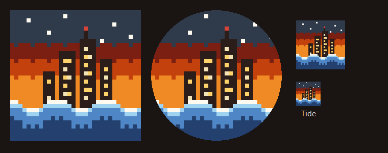

# The app is called Tide, with a new icon

**What:** the phone app's name and icon.
- **Name:** the home-screen name, the page title and the app's own words for itself ("Tide keeps trying", "Tide is updating…", the Settings version row, the sign-off alert) say **Tide**; it was "The Board". The Board stays the name of the home tab.
- **Icon:** a night skyline over an ember dusk with the tide rolling in, in the same pixel style and sprites.js palette as the rest of the app (D-3). `pass-app/icon-art.mjs` draws it from one 32x32 grid and writes `icon.svg` plus `icon-192.png` and `icon-512.png` (whole-pixel scales encoded with zlib: no browser, no new dependency). The skyline sits inside the maskable safe circle (farthest corner 197.9 px from the centre; the circle ends at 204.8), so round and squircle launcher crops never cut it. The top of the sky is slate, not the app's own dark, so the icon's edge shows on a dark home screen.
- **Where:** the manifest lists the SVG and both PNGs; the apple-touch icon and notifications use the 192 PNG (Android does not draw SVG notification icons); the service worker caches the PNGs; the server serves them before sign-in like the SVG ("Add to Home Screen" needs them). The manifest `id` and `scope` are unchanged, so the installed app updates in place instead of becoming a second app.

**Why:** Jordan asked for a new name and icon and left the choice to the lead (D-13). Android builds its home-screen icon from PNGs; an SVG-only manifest can come out blurry or badly cropped.

**On the phone:** Chrome checks an installed app's manifest when the app opens (about once a day), so the new name and icon arrive on their own. Samsung Internet can keep the old ones; removing the app from the home screen and adding it again picks them up.

**Not changed:** the push alert title in `kitchen/notify.ps1` still says "The Board" (push alerts are off, D-10); the code names (`pass-app/`, the `Kitchen-Pass` task) stay.

**Preview** (square, round crop, 96 px and 48 px):

**Tests:**
- `tests/Test-PassApp.ps1`: 1299 passed, 0 failed. Changed checks: the manifest name is Tide; the same art everywhere (manifest SVG + 192 + 512 PNGs, favicon, apple-touch PNG, shell cache, served before sign-in, notifications use the PNG). New check: the SVG and both PNGs are exactly what `icon-art.mjs` draws, at their stated sizes. The existing safe-zone and palette check passes on the new art.
- `tests/Test-Standards.ps1` 20/0, `tests/Test-Work.ps1` 118/0, `tests/Test-BoardDeploy.ps1` 20/0, `tests/Test-Privacy.ps1` 31/0.

**L1-L4:** person: a clear, sharp home-screen icon and one name for the app. Business, MSP, community: none.
